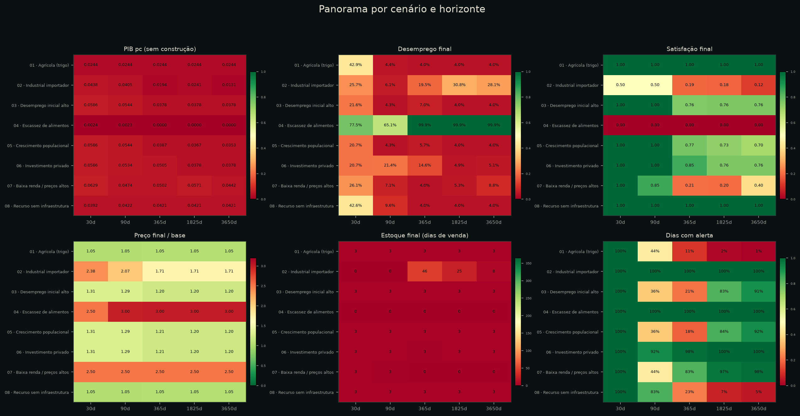
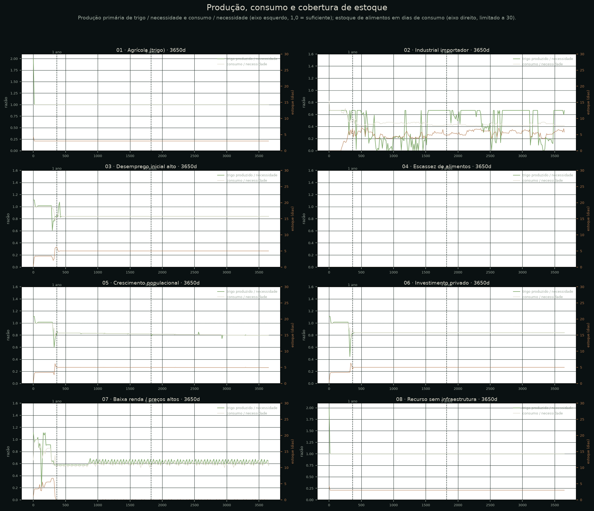
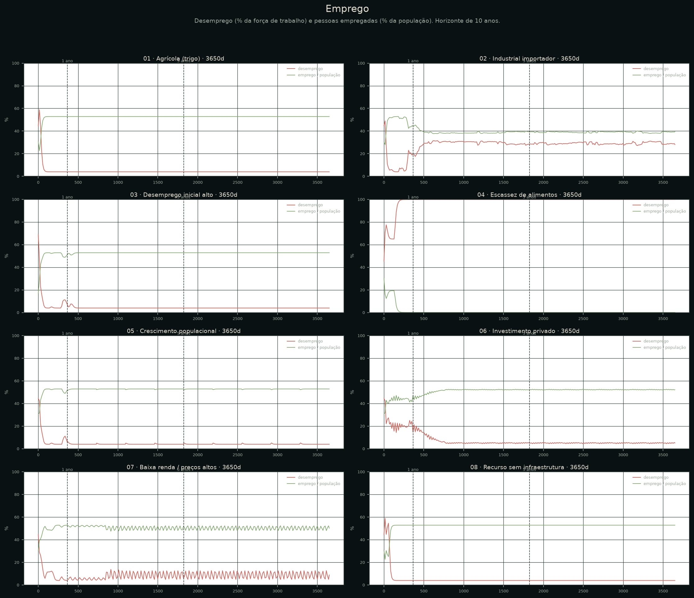
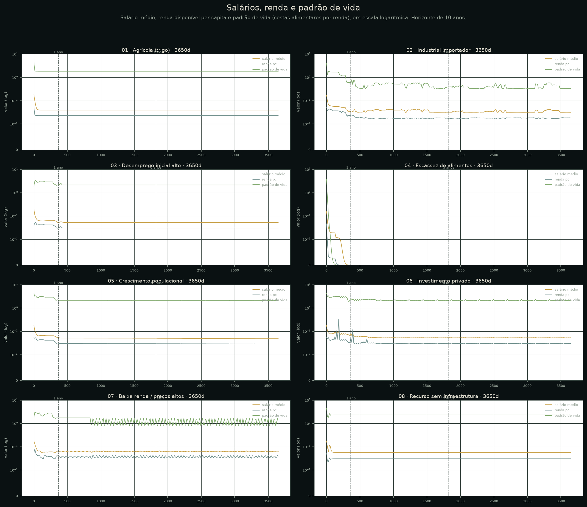
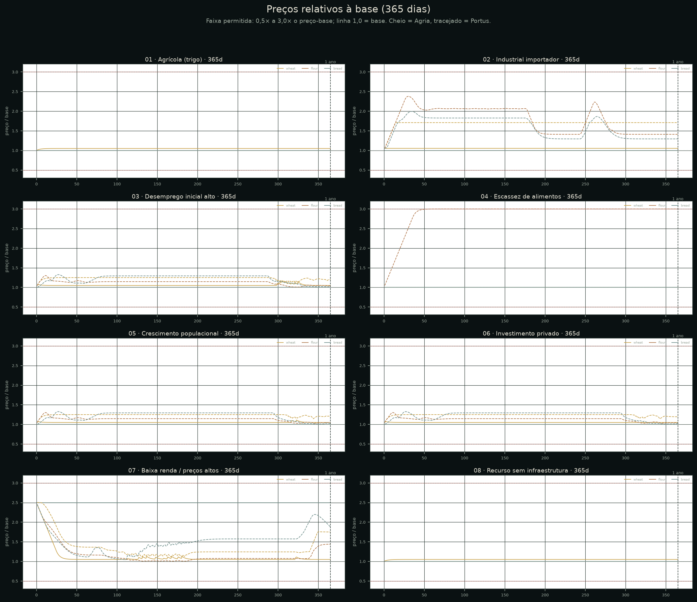
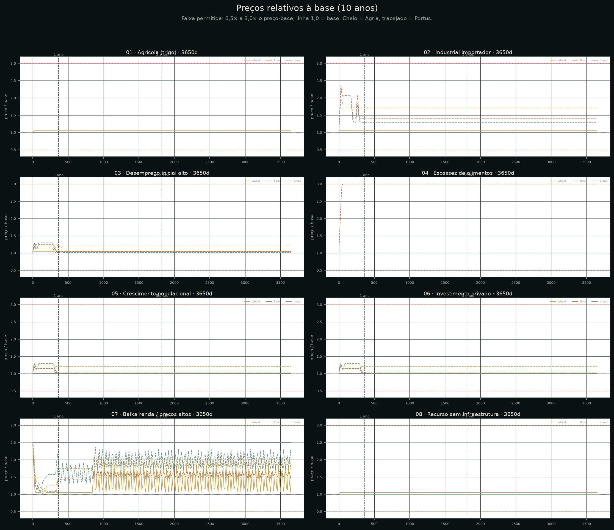
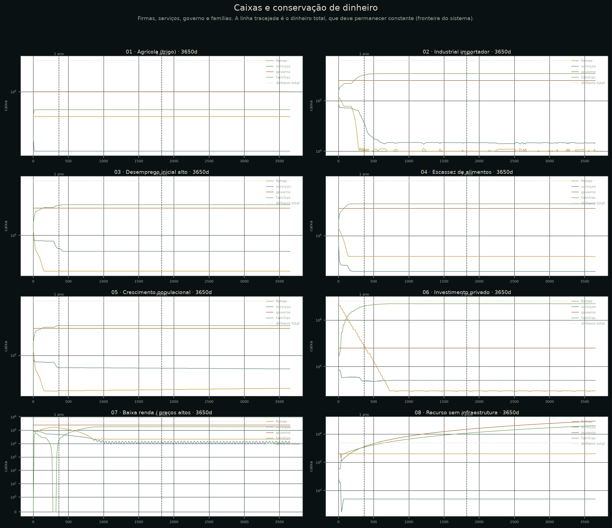
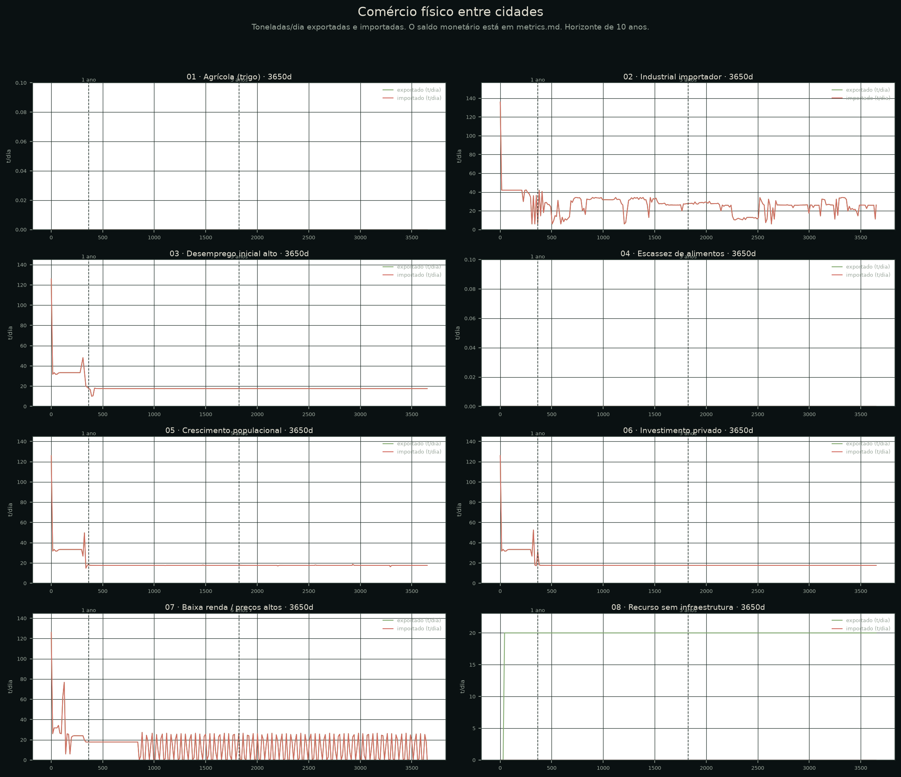
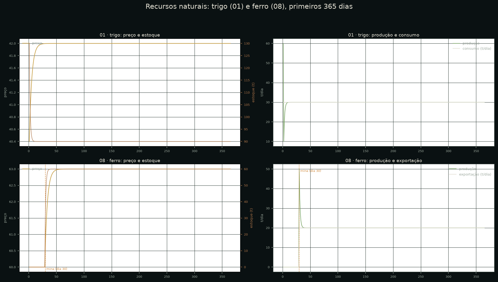
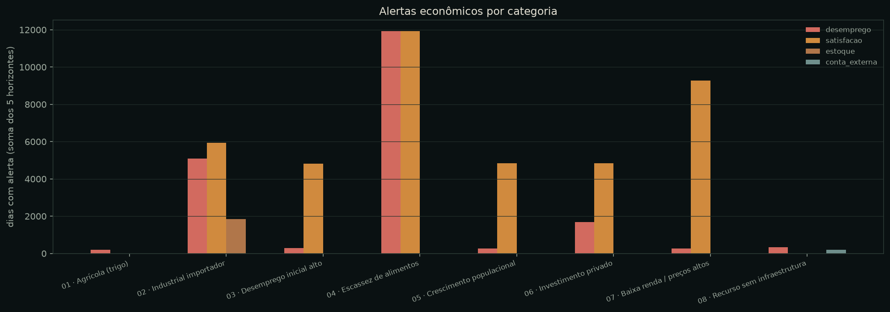

# Relatório de estabilidade econômica — WarEconomy

**Data:** 2026-11-09 · **Runner:** `tools/economy_lab.gd` (`--tag=final`) · **Núcleo:** `EconomySim` demo (`tick_demo`)
**Execuções:** 8 cenários × 5 horizontes = 40 · **Violações de invariantes:** 0

---

## 1. Resumo executivo

1. **A economia é contabilmente estável.** Nas 40 execuções, o dinheiro total ficou exatamente
   constante (variação máxima de 0,000000 dentro de cada run), nenhum caixa doméstico, estoque ou
   poupança ficou negativo, o PIB permaneceu igual ao valor adicionado, a produção não passou da
   capacidade e os preços ficaram em [0,5×, 3,0×] a base, com passo diário máximo de **5,00%**.
2. **Sete defeitos foram corrigidos** no núcleo e no laboratório. Os principais: duplo passo diário
   de preço, caixa negativo por folha/importação sem liquidez e estoque acumulando para sempre. Um
   quarto problema — desemprego de 77–90% em todas as cidades — era um artefato de salário fixo +
   teto de serviços, não um resultado econômico. Os demais estão na §3.
3. **As crises que restaram são plausíveis, não falhas contábeis.** Os cenários 02 (importador sem
   produção de trigo), 04 (sem alimentos) e 07 (baixa renda/preços altos) entram em depressão/fome;
   o cenário 05 mostra pressão malthusiana; o 06 mostra sobrecapacidade sem produtividade; o 08
   mostra renda de recurso com conta externa negativa. Nenhum desses casos viola conservação.
4. **O maior risco restante é de modelagem, não de bug:** serviços pagos antes do alimento, mercado
   de trabalho dual (2,0/dia vs 0,03/dia), ausência de crédito/governo comprador e conta externa sem
   orçamento. Esses pontos estão em §8 e §9.



---

## 2. Método

- **Mesma simulação:** `EconomySim.initialize_demo()` + `tick_demo()`. O laboratório só altera o
  estado inicial (cidades, construções, estoques, preços, caixa) e aplica eventos declarados
  (crescimento populacional, investimento, construção da mina). Nenhuma segunda economia.
- **Horizontes:** 30, 90, 365, 1825 (5 anos) e 3650 dias (10 anos).
- **Amostragem:** diária até 365 dias; a cada 7 dias em 1825; a cada 14 dias em 3650.
- **Determinismo:** sem aleatoriedade no núcleo demo; duas execuções independentes (`final` e
  `check`) produziram métricas idênticas (diferença 0 nas colunas comparadas).
- **Configuração:** `data/definitions/economy/balance.json` (cenários, preços-base, horizontes,
  amostragem, limiares e o bloco `model` aplicado via `demo_set_balance`). Saídas em
  `docs/economy_lab/final/` (`runs.csv`, `runs.json`, CSVs por cenário/horizonte) e gráficos em
  `docs/economy_lab/charts/`.

### Invariantes duras verificadas a cada dia

| Invariante | Critério |
|---|---|
| Conservação de dinheiro | `money_total` não muda além de 0,5 |
| Caixas e poupança | firmas, serviços, governo e famílias ≥ 0 |
| Estoques | ≥ 0 e finitos |
| Preços | finitos, em [0,5×, 3,0×] a base, passo diário ≤ 5% |
| PIB | igual a valor adicionado + receita de serviços |
| Produção | ≤ capacidade nominal; finita |
| Trabalho | empregado + desempregado = força de trabalho; sem negativos |
| Consumo | ≤ necessidade; satisfação em [0,1] |

**Alertas econômicos** (não falham o teste): desemprego > 25%, satisfação < 0,8, estoque > 365 dias
de venda e conta externa negativa. Eles separam “crise plausível” de “violação contábil”.

---

## 3. Bugs corrigidos e evidência

| # | Sintoma observado | Causa | Correção | Antes → depois |
|---|---|---|---|---|
| 1 | Salto de preço de **25,08** e **4,00** no dia 1 em Portus | Importação aplicava ±5% e a reação de mercado aplicava outros ±5% no mesmo tick | Limite diário único, aplicado no fim do tick, depois de todas as regras | 99 violações → **0**; passo máximo 5,00% |
| 2 | `firm_cash` negativo por centenas/milhares (02 dia 563: −339; 04 dia 134: −400; 07 dia 1545: −206) | Folha/opex e compra de trigo não verificavam caixa | Folha/opex limitados ao caixa; importação limitada ao caixa disponível | 0 caixas negativos nas 40 runs |
| 3 | `service_cash` negativo (01 dia 42: −134) | Serviço pagava folha sem caixa | Folha de serviços limitada ao caixa do dia | 0 caixas negativos |
| 4 | Estoque de ferro crescendo ~2 t/dia para sempre | Produção mirava `vendas × 1,10` sem estoque-alvo | Estoque-alvo de 3 dias; repõe metade da diferença por dia | Estoque de ferro estabiliza em ~60 t; `stock_days` 3–52 |
| 5 | Desemprego de **77–90%** em todas as cidades, inclusive Agria isolada | Salário de serviços fixo em 0,15/dia (3× o PIB pc) + teto de 30% da população; força de trabalho 55% | Salário de serviços busca o equilíbrio do trabalho residual, com piso de subsistência e 4% friccional | 84,9% → **4,0%** (01); 90,8% → 99,9% (04, colapso real) |
| 6 | PIB de investimento não contabilizado | `demo_invest`/`demo_build` somavam receita antes do reset de fluxos | `construction_revenue_pending` entra no PIB do tick seguinte | 08 dia 30: PIB pc 1,039 total / 0,0392 sem construção, agora explícito |
| 7 | Falso positivo “produção acima da capacidade” | Comparava produção com capacidade já reduzida por `output_scale` no mesmo tick | Comparação com capacidade nominal | 0 falsos positivos |

O caso 5 merece ênfase: o número antigo não era “desemprego alto”, era uma **identidade aritmética**
(salário fixo alto + teto de 30% de serviços + 55% de participação). A correção não força resultado
positivo: o desemprego agora emerge da receita de serviços e do piso de subsistência. Nos cenários
de crise ele sobe para 28–100%.

> **Teste de IA ajustado:** o cenário de “excesso de farinha” injetava 500 t e rodava 30 dias. Com o
> estoque-alvo de 3 dias, esse excesso é absorvido em ~8 dias e a IA pode investir depois que ele
> acaba — corretamente. A janela do teste passou a 7 dias para observar a decisão de cautela
> enquanto o excesso existe (`tools/economy_ai_test.gd`).

---

## 4. Resultado por cenário (10 anos)

Valores do último dia; PIB pc exclui receita de construção one-off. Tabela completa em
[`final/metrics.md`](final/metrics.md).

| Cenário | PIB pc | Desemp. | Satisf. | Preço/base | Estoque (dias) | Lucro/dia | Poupança | Leitura |
|---|---:|---:|---:|---:|---:|---:|---:|---|
| 01 Agrícola | 0,0244 | 4,0% | 1,00 | 1,05 | 3 | 210 | 60.706 | Estável; trigo excedente, sem indústria |
| 02 Industrial importador | 0,0131 | 28,1% | 0,12 | 1,71 | 8 | 100 | 344.769 | Crise de demanda/fome por déficit físico de trigo |
| 03 Desemprego inicial alto | 0,0378 | 4,0% | 0,76 | 1,20 | 3 | 2.090 | 280.383 | Ajuste em ~90 dias; não é desemprego estrutural |
| 04 Escassez de alimentos | 0,0000 | 99,9% | 0,00 | 3,00 | 0 | 0 | 289.703 | Colapso total; sem oferta e sem mercado externo |
| 05 Crescimento populacional | 0,0353 | 4,0% | 0,70 | 1,20 | 3 | 2.208 | 272.536 | Pressão malthusiana; produção fixa |
| 06 Investimento privado | 0,0378 | 5,1% | 0,76 | 1,20 | 3 | 2.090 | 2.238.543 | Capacidade 85→1.018 t/dia, produção ~47 t/dia |
| 07 Baixa renda/preços altos | 0,0442 | 8,8% | 0,40 | 2,50 | 0 | 3.397 | 184.288 | Armadilha de pobreza; serviços antes do alimento |
| 08 Recurso sem infraestrutura | 0,0421 | 4,0% | 1,00 | 1,05 | 3 | 970 | 1.985.290 | Mina no dia 30; renda de ferro, conta externa −4,56 M |

### 01 · Cidade agrícola produtora de trigo

Três fazendas produzem 60 t/dia de trigo para 100 mil habitantes (necessidade 30 t/dia); não há
moinho/padaria. O excedente fica em estoque (~90–130 t). Preço do trigo converge para 42 (1,05× a
base), satisfação 1,00 e desemprego 4% após o ajuste inicial. **Estável.** Não há comércio porque a
outra cidade foi removida; é o caso de economia fechada de um só bem.



### 02 · Cidade industrial dependente de importações

Portus perde as duas fazendas; restam moinho e padarias. A oferta primária cai de 100 para 60 t/dia
para uma necessidade de 90 t/dia: **déficit físico de 30 t/dia**. Portus importa trigo de Agria, mas
o caixa da cidade drena e a importação é limitada pela liquidez. O resultado é depressão: desemprego
sobe de 6% para 28%, satisfação cai para 0,12 e o PIB pc para 0,0131. **Crise plausível** (déficit
físico + cidade sem crédito), não bug. Para transformar em cenário de política, seria preciso modelo
de crédito, compras públicas ou mercado externo de alimentos.

### 03 · Cidade com desemprego inicial alto

O cenário começa com apenas 10% da população em serviços. Com o salário de serviços flexível, o
mercado absorve a mão de obra em ~90 dias: desemprego 21,6% (30d) → 4,3% (90d) → 4,0% (10 anos).
O salário de serviços cai e a distribuição de renda muda, mas o PIB não é inflado. **Não há
desemprego estrutural persistente** neste modelo; o rótulo do cenário descreve o choque inicial, não
o equilíbrio. Se o objetivo for desemprego persistente, é preciso modelar matching, qualificação ou
segmentação — não travar o salário.

### 04 · Cidade com escassez de alimentos

Sem fazendas, sem padarias e com estoques zerados, não há oferta local nem importação de alimentos.
A produção é zero, a satisfação é zero e o desemprego chega a 99,9%; o PIB zera. Os preços de farinha
sobem até o teto de 3,0× e o caixa das firmas zera. **Crise plausível de colapso**, mas extrema: o
modelo não tem mercado externo de alimentos, crédito, ajuda humanitária ou governo comprador. Não é
“preço negativo” nem “produção infinita”.

### 05 · Cidade com crescimento populacional

População cresce 1% ao ano (aplicado pelo laboratório; o núcleo não modela demografia). A capacidade
produtiva fica fixa. Em 10 anos a população sobe ~9,4% e a satisfação cai de 1,00 para 0,70; o PIB pc
cai de 0,0586 para 0,0353. **Pressão malthusiana plausível.** O modelo não tem natalidade, migração
ou investimento induzido por população; o cenário mede só o descompasso demanda/oferta.

### 06 · Cidade com forte investimento privado

Agria começa com 2 M de caixa e reinveste 15% do caixa a cada 30 dias em uma fazenda. Em 10 anos,
**1,98 M** são investidos e a capacidade nominal chega a 1.018 t/dia, mas a produção fica em ~47 t/dia
porque segue as vendas. O caixa das firmas vira poupança das famílias (2,24 M) e o PIB pc fica em
0,0378, abaixo do pico inicial. **Investimento possível, mas sem retorno de produtividade**: a regra
só adiciona capacidade, não reduz custo nem cria demanda. É um caso de sobrecapacidade plausível;
recomenda-se uma regra de ROI/retorno esperado antes de investir.

### 07 · Cidade com baixa renda e preços elevados

Preços iniciam 2,5× a base e famílias sem poupança. Portus (com moinho/padarias) converge para
preços menores, mas Agria, que não produz farinha/pão, mantém o preço inicial desses bens (o mercado
não tem produtor local e o preço não é recotizado). A satisfação em Agria cai para 0,18–0,40 e a
renda per capita oscila; em Portus fica em ~0,64. **Armadilha de pobreza + limitação de modelo**
(bens não produzidos localmente ficam com preço congelado; serviços são pagos antes do alimento).

### 08 · Cidade com recursos naturais e sem infraestrutura

Agria tem aptidão de ferro, mas nenhuma mina. Até o dia 30, o recurso não gera renda. No dia 30 o
laboratório constrói uma mina estatal (50 t/dia de capacidade, 200 empregos). A produção sobe para
50 t/dia, a exportação estabiliza em 20 t/dia, o preço do ferro sobe de 60 para 63 e o PIB pc
estabiliza em 0,0421 (o dia da construção aparece como 1,0392 no PIB total e 0,0392 sem a receita de
construção). **Recurso vira renda**, mas a conta externa fica em **−4,56 M** em 10 anos: o comprador
externo paga com crédito sem limite. O dinheiro doméstico é conservado; o passivo é externo.
**Funciona, com ressalva de modelo.**




---

## 5. Indicadores transversais

### 5.1 PIB e PIB per capita

- PIB pc diário entre **0,0131 e 0,0629**, excluindo o dia de construção do cenário 08 (1,0392);
  não há crescimento exponencial nem “crescimento sem produção”. O maior valor é o cenário 07 no
  dia 30 (0,0629) e o menor é o colapso do 04 (0,0000).
- O investimento do cenário 06 **não** aumenta o PIB pc no longo prazo (0,0586 → 0,0378): capacidade
  ociosa e preços menores. Isso é consistente com “investimento sem demanda não é crescimento”.
- O recurso do cenário 08 eleva o PIB pc de 0,039 para 0,042 e gera renda de exportação; é o único
  caso de renda de recurso natural.

### 5.2 Produção, consumo e estoques

- Produção nunca excede a capacidade; não há “produção infinita”.
- Estoque normal: **3–5 dias** de venda. Cenário 02: ~52 dias de trigo/farinha em alguns períodos
  (estoque encalhado por falta de demanda/liquidez). Cenário 04: 0.
- Consumo ≤ necessidade em todas as execuções; a fome aparece como consumo abaixo da necessidade,
  não como consumo acima da renda.

### 5.3 Preços

- Faixa observada: **1,00× a 3,00×** a base; nenhum preço negativo ou não finito.
- Passo diário máximo: **5,00%** (limite), verificado nos CSVs diários de 365 dias.
- Não há inflação explosiva nem deflação permanente: o cenário 06 não derruba preços abaixo da base
  porque a produção segue a demanda, e o cenário 04 fica no teto por escassez física.
- O caso 07 revela um limite: bens sem produtor local (farinha/pão em Agria) mantêm o preço inicial
  de 2,5×; não há arbitragem nem comércio desses bens.




### 5.4 Emprego, salários e padrão de vida

- Desemprego normal: **4,0%** (friccional). Crises: 28% (02), 99,9% (04), 8,8% (07).
- Salário médio: ~0,02–0,08/dia; o salário de serviços é o clearing do trabalho residual e fica
  próximo do custo de subsistência. O salário industrial/agrícola permanece fixo em 2,0/1,5, criando
  um diferencial de ~60×. **É a principal inconsistência de calibração restante.**
- Padrão de vida (cestas por renda): 1,8–2,5 nos cenários normais; 0,3–0,9 nas crises (02/07) e 0
  no colapso (04).
- A satisfação alimentar é o indicador mais sensível: 1,00 nos cenários normais, 0,70–0,76 com
  crescimento/choque, 0,12–0,40 nas crises.

### 5.5 Lucros, investimento e poupança

- Lucro diário normal: 210–3.397; cenário 02: ~100 (quase zero); cenário 04: 0.
- Não há lucro negativo permanente com caixa negativo: a regra de liquidez corta folha/opex e o
  `output_scale` reduz a produção após 10 dias de prejuízo.
- Investimento do cenário 06: 1,98 M; poupança das famílias 2,24 M. O dinheiro não some: sai do
  caixa da firma, vira receita de construção/serviços e depois renda das famílias.
- **Poupança** sobe nos cenários de renda alta (08: 1,99 M) e zera no cenário 02 (Portus);
  no 07 fica em 1,6 mil em Agria e 183 mil em Portus — armadilha de pobreza concentrada.



### 5.6 Comércio entre cidades

- O comércio físico é trigo de Agria → Portus e pão de Portus → Agria (até 6 t/dia).
- Cenário 02: Portus importa 20–40 t/dia enquanto tem caixa; quando o caixa zera, a importação para
  e a cidade entra em fome. O saldo comercial interno é zero por construção (duas cidades, mesma
  nação); o que muda é a **distribuição** de caixa entre elas.
- Cenário 08: exportação de ferro 20 t/dia; saldo externo +1.260/dia em valor, mas pago por
  `foreign_cash` negativo (−4,56 M em 10 anos). O dinheiro doméstico é conservado.



### 5.7 Recursos naturais

- Trigo: 60 t/dia em Agria; estoque 90–130 t; preço 40 → 42.
- Ferro: mina no dia 30; produção 50 t/dia → 20 t/dia (exportação); estoque estabiliza em ~60 t;
  preço 60 → 63. Sem a mina, o recurso não gera renda.
- O recurso é **finito?** Não: o modelo demo não tem esgotamento de depósito; a mina produz
  indefinidamente. É uma simplificação a documentar (o modo legacy tem depósitos, o demo não).
- A aptidão territorial (`suitability_wheat`, `suitability_iron`) fica registrada por cidade/dia nos
  CSVs, junto com estoque, produção e preço.



### 5.8 Alertas econômicos



Os alertas se concentram em: transição de emprego (primeiros ~40 dias), desemprego/satisfação nos
cenários 02/04/07, estoque encalhado no 02 e conta externa no 08. Nenhum alerta é violação contábil.

---

## 6. Crises plausíveis × bugs

| Fenômeno | Onde | Classificação | Evidência |
|---|---|---|---|
| Salto de preço de 10% no dia | Todos | **Bug corrigido** | Passo máximo agora 5,00% |
| Caixa negativo | 01, 02, 04, 07 | **Bug corrigido** | 0 caixas negativos em 40 runs |
| Estoque crescendo sem limite | 08 (ferro) | **Bug corrigido** | Estoque ~60 t; a regra antiga crescia ~2 t/dia sem limite |
| Desemprego 77–90% | Todos | **Artefato de regra corrigido** | 4,0% normal; crises reais sobem |
| Fome com alimento em estoque | 02, 07 | **Crise de demanda/liquidez** | Serviços antes do alimento; sem crédito/governo |
| Fome total | 04 | **Crise plausível** | Oferta zero, sem mercado externo |
| Pressão populacional | 05 | **Crise plausível** | Produção fixa, necessidade +9,4% em 10 anos |
| Sobrecapacidade sem produção | 06 | **Comportamento plausível** | Capacidade 1.018 t/dia, produção ~47 t/dia |
| Conta externa negativa infinita | 08 | **Limitação de modelo** | −4,56 M; dinheiro doméstico conservado |
| Preço de bem sem produtor congelado | 07 (Agria) | **Limitação de modelo** | Farinha/pão em 2,5× por 10 anos |

---

## 7. O que NÃO foi forçado

- Não foi imposto piso de desemprego, piso de PIB, piso de lucro, nem inflação-alvo.
- Não foi alterado o resultado dos cenários de crise para “ficar bonito”: 02, 04 e 07 continuam
  severos.
- Não foi criada uma segunda simulação: o laboratório usa o mesmo `EconomySim` e o mesmo `tick_demo`.
- Não foi mudada a ordem de dezenas de parâmetros de uma vez: as correções foram regras isoladas,
  com uma execução de 40 casos entre cada uma; o efeito de cada uma está na §3.

---

## 8. Limitações conhecidas

1. **Serviços antes do alimento.** 45% da renda disponível vai para serviços antes da compra de
   comida. Em escassez, a cidade pode passar fome com alimento em estoque. Uma variante “alimento
   primeiro” foi testada e derrubou a demanda de serviços (desemprego 52% em Agria), porque serviços
   são 45% da demanda; por isso foi revertida. O caminho correto é crédito/transferência/governo
   comprador, não inverter a ordem sem mais mecanismos.
2. **Mercado de trabalho dual.** Serviços ~0,03/dia; agricultura/indústria 2,0/1,5. O diferencial é
   grande demais para uma economia europeia. Recomenda-se calibrar salários nominais ou indexar com
   prêmio e piso, testando o efeito sobre custo, preço e lucro.
3. **Sem crédito, governo comprador, seguro-desemprego ou mercado externo de alimentos.** As crises
   02/04/07 são de demanda/liquidez; o modelo só tem caixa à vista.
4. **Sem demografia.** O crescimento do cenário 05 é aplicado pelo laboratório; o núcleo não tem
   nascimentos, mortes ou migração.
5. **Conta externa sem orçamento.** O ferro do cenário 08 é pago por crédito externo infinito.
6. **Construção one-off.** Um investimento grande aparece como receita de construção em um único
   tick e cria um pico de PIB; o relatório usa PIB pc sem construção para comparar cenários.
7. **Recurso não esgota no demo.** A mina produz indefinidamente; o modo legacy tem depósitos, o
   demo não.
8. **Emprego x folha parcial.** Quando o caixa não cobre a folha, o pagamento é reduzido pro-rata,
   mas o posto ainda conta como empregado; a renda média captura a diferença, não há demissão
   imediata. É uma aproximação de arrecadação/arrears, não de mercado de trabalho com matching.

---

## 9. Recomendações de balanceamento (uma mudança por vez)

| Prioridade | Mudança | Efeito esperado | Como medir |
|---|---|---|---|
| P1 | Unificar salário de serviços e salário industrial com prêmio e piso | Reduz diferencial de 60×; muda custo/preço/lucro | `wage_avg`, `profit_end`, `price_ratio_end` nos 8 cenários |
| P1 | Adicionar crédito de curto prazo ou compras públicas emergenciais | Evita fome com estoque; estabiliza 02/07 | `satisfaction_end`, `firm_cash_end`, `alerts` |
| P2 | Orçamento para a conta externa (limite de crédito) | Impede passivo externo infinito no 08 | `foreign_cash_end`, exportação de ferro |
| P2 | Regra de investimento com ROI (capacidade só se demanda/lucro esperado > custo) | Evita sobrecapacidade do 06 | `capacity_end`, `production_end`, `profit_end` |
| P3 | Demografia endógena (natalidade/migração) | Crescimento populacional deixa de ser choque externo | cenário 05, `population_end`, `need_end` |
| P3 | Esgotamento de depósito no demo | Recurso natural deixa de ser infinito | cenário 08, estoque/produção de ferro |
| P4 | Prioridade alimentar com crédito/transferência (não só inverter a ordem) | Reduz fome sem colapsar serviços | 02/07, satisfação e desemprego |

**Regra de ouro:** rode o laboratório com `--tag=antes` e `--tag=depois`, compare `runs.csv` e só
então mexa no próximo parâmetro. Cada alteração deve ter uma hipótese e uma métrica.

---

## 10. Reprodução

```powershell
$godot = "C:\Users\artur\OneDrive\Área de Trabalho\Godot_v4.7.2-stable_win64.exe"

# build do núcleo (debug é o usado pelo editor/headless)
$env:PATH = "G:\tools\cpp-tools\Scripts;G:\tools\llvm-mingw-20261104-ucrt-x86_64\bin;$env:PATH"
cmake --build gdextension/build-debug
cmake --build gdextension/build-release

# 8 cenários × 5 horizontes
& $godot --headless --path . --script res://tools/economy_lab.gd -- --tag=final

# gráficos e métricas
& "C:\Users\artur\AppData\Local\Python\bin\python3.exe" tools/economy_report.py --tag final

# testes rápidos de regressão
& $godot --headless --path . --script res://tools/population_demo_test.gd
& $godot --headless --path . --script res://tools/economy_integration_test.gd
& $godot --headless --path . --script res://tools/economy_ai_test.gd
```

Saídas: `docs/economy_lab/final/runs.csv`, `runs.json`, `final/<cenário>/<dias>d.csv`,
`docs/economy_lab/charts/*.png`, `docs/economy_lab/final/metrics.md`.

**Testes executados nesta auditoria:** `economy_lab.gd` (40/40, 0 violações),
`economy_integration_test.gd` (OK), `economy_ai_test.gd` (OK; janela do glut ajustada para 7 dias),
`population_demo_test.gd` (OK) e `economy_long_run_test.gd` (365 dias, OK). O
`economy_panel_test.gd` não foi rodado por causa do BOM pré-existente em
`core/ui/city_economy_panel.gd`.

---

## Anexo A — todas as execuções

Consulte [`final/metrics.md`](final/metrics.md) para a tabela de 40 linhas com PIB pc, desemprego,
satisfação, preço, estoque, alertas e violações. Os CSVs permitem reconstruir qualquer série dos
gráficos.
